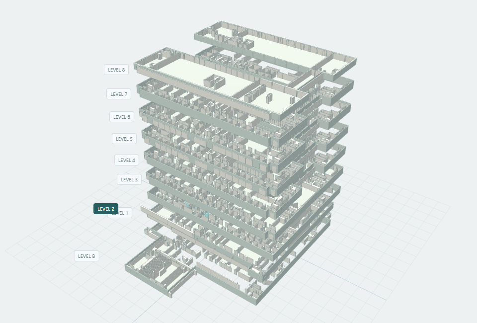
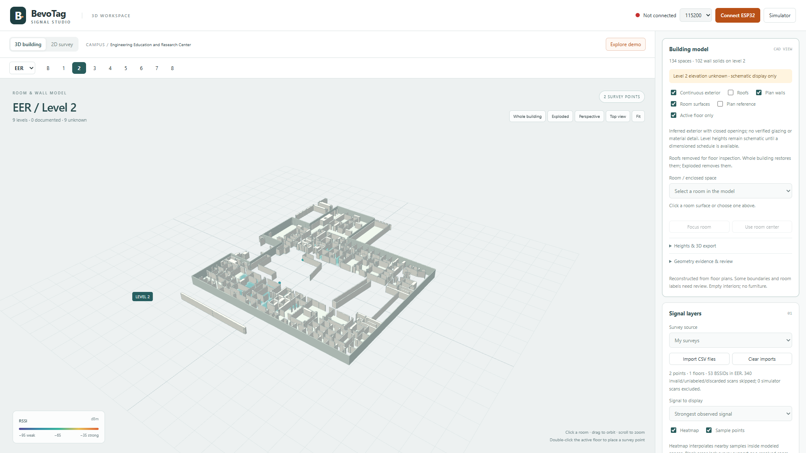

# Individual Risk Reduction: Web App 3D Building Model and Signal Map

| | |
|---|---|
| **Student** | Li Shi |
| **Team** | BevoTag (SP11) |
| **Technical TA** | Michael Zhao |
| **Faculty mentor** | Dr. Haris Vikalo |
| **Due** | Fri Nov 20, 2026, 5:00 pm |

> **Grading (0 to 10, Technical TA):** (1) follows the guidelines, (2) done before the deadline,
> and (3) achieves **useful, significant results**. Point 3 matters most, so show measured numbers
> and say what they mean for the design.

## 1. Risk addressed

BevoTag must show a lost item's position, including its floor, in multi-storey campus buildings. This activity tests two risks:

- **User interface:** can a browser app show real campus buildings in 3D with Wi-Fi signal data and a position estimate on the correct floor?
- **Data pipeline:** can survey logs from the ESP32 collector be imported, matched against new scans, and displayed without manual work?

## 2. What I built

The **3D building** tab of Signal Studio (`Experiments/Campus_Map/collector/`), a browser app built on Three.js with no build step.

- **3D models of three buildings** reconstructed from the campus floor-plan PDFs: EER (9 levels), ECJ (15) and ASE (7), for 31 plan levels and 3,403 wall and space polygons. EER and ECJ have continuous exterior walls and removable roofs, and EER has its atrium stairs and bridge. Assembled and exploded views are available.
- **Signal map:** survey points, plus a heatmap of the strongest RSSI or of one chosen BSSID. The heatmap interpolates within 60 ft on the same floor and is clipped to rooms.
- **CSV import** of collector logs. It filters simulator and discarded rows, removes duplicate imports and averages repeated scans.
- **Position estimate:** a k-nearest-neighbor fingerprint match that uses up to 32 BSSIDs and up to 5 weighted neighbors, with a -100 dBm penalty for a missing BSSID and at least 3 survey points. It votes for the floor, then averages X/Y on that floor and shows a marker in 3D.
- **AP-per-room simulation:** one assumed AP at the center of every room, with log-distance path loss, -5 dB per wall and -15 dB per floor. It produces a full synthetic survey for testing the pipeline before real data exists.
- **IFC4 and OBJ export** of the models for CAD/BIM tools.

## 3. Method and test setup

- **Automated tests:** Node tests cover the geometry, exports, CSV import, the position estimator and the simulation; Python tests cover the plan-reconstruction and review scripts.
- **Export validation:** the IFC4 files were opened with IfcOpenShell 0.9.0, every solid was tessellated, and volumes were compared with footprint area times height.
- **Browser checks:** EER and ECJ in whole-building and exploded views, roofs on and off, top view, and a 390 px phone-width layout, with the console checked for errors.
- **Floor heights:** ECJ levels checked against the 2013 record drawings.
- **End-to-end run:** synthetic survey (demo and simulation), then heatmap, then position estimate, then the 3D marker.
- **Held-out accuracy test (Nov 19):** the AP simulation produced a survey of EER Levels 1–3 on a 10 ft grid (1,452 points). Then 300 test scans were taken at random positions inside Level 2 rooms, not on the grid, with Gaussian RSSI noise added, and each was run through the position estimator. Three cases: one AP in every room (134 on Level 2) with 4 dB noise; sparse APs in the largest 20% of rooms (27 on Level 2), closer to real campus density, with 4 dB noise; and the sparse case with 8 dB noise.

## 4. Results

| Check | Result |
|---|---|
| Node tests | **80/80 pass** (Nov 19, 2026) |
| Python tests | **19/19 pass** (Nov 19, 2026) |
| IFC4 export | 1,906 solids, **0 schema or solid errors**; volume error at most 2.7 × 10⁻¹⁰ |
| Browser checks | No console errors; no horizontal overflow at 390 px |
| ECJ floor heights | 11 of 15 levels documented, 1 estimated, 3 unknown |
| End-to-end pipeline | Works on synthetic data: estimate lands on the correct floor |
| **Held-out accuracy, simulated EER Level 2** (300 scans each) | Floor correct **100%**. Median error **1.5 m** (AP in every room, 4 dB noise), **1.8 m** (sparse APs, 4 dB), **2.3 m** (sparse APs, 8 dB). Room hit rate **72% / 62% / 49%** |
| Real ESP32 data | Only 4 RSSI scans at 3 points in EER 2.701 and 2.813 (Oct 11); too few to measure accuracy |

Figure 1 shows the EER model in the exploded view, and Figure 2 shows real ESP32 survey data from Level 2 loaded into the web app.

More screenshots are in `docs/oral-design-review/assets/screenshots/`.

## 5. What the results mean for the design

- **User-interface risk reduced:** a working 3D map shows signals and a position estimate on the right floor of real campus buildings, so the EE 464 user app can build on it instead of starting from scratch.
- **Data-pipeline risk reduced:** the survey CSV format, import, fingerprint matching and display are built and tested, so real survey data can be dropped in.
- **Accuracy targets:** in simulation, the estimator finds the floor every time and meets the **5 m median-error target** with margin (1.5 to 2.3 m). It falls well short of the **90% room identification target** (49 to 72%), and the gap widens as APs get sparser and noise grows. Room identification, not distance error, is the hard goal. This matches the Prior Art finding and supports adding wall-aware fusion (for example, a particle filter that uses the floor plans).
- **Remaining risk identified:** accuracy on real data. The simulation's path-loss values are uncalibrated, so these numbers show the method's behavior, not field performance. A real survey with held-out test points is still needed.

## 6. Limitations and next steps

- Measure room hit rate and position error on real EER Level 2 surveys with held-out points.
- Floor heights: 19 of 31 levels are unknown (all of EER and ASE), so vertical placement is schematic.
- The simulation's path-loss values are uncalibrated assumptions.
- Walls do not constrain the estimate, so it can land on the wrong side of a wall.
- The browser-to-ESP32 loop has not been tested on a physical board.

## 7. Demo steps

1. Double-click `Experiments/Campus_Map/start-webapp.bat` (or run `./start-webapp.sh`). It opens http://localhost:8765.
2. Open the **3D building** tab and click **Explore demo**: EER with synthetic coverage and a sample estimate.
3. Switch between **Whole building** and **Exploded**, and toggle **Roofs**.
4. Choose **Survey source → Simulation · AP in every room** to show the predicted heatmap.
5. Run the tests: `node --test tests/*.test.mjs` in `Experiments/Campus_Map/collector/`.

## 8. Files

- `Experiments/Campus_Map/collector/` (`studio.mjs`, `model-view.mjs`, `signal-model.mjs`, `architecture*.mjs`, `ap-simulation.mjs`, `tests/`)
- `docs/3d-model-status.md`: detailed status, accuracy limits and verification
- `docs/floor-height-sources.md`, `docs/cad-source-review.md`: source evidence
